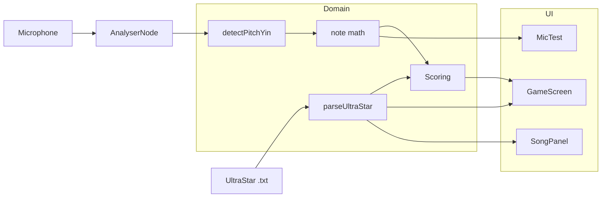

# Design Document

## Overview

GhostNote is a client-only React application. Song parsing and pitch detection are pure TypeScript modules with no DOM dependency, so they can be unit-tested with fixture text and synthesized sines. The UI is a thin layer that loads files, requests the microphone, and (from Phase 2) synchronizes playback, note highlighting, and scoring.

Phase 1 delivers the foundation. Phase 2 adds timing, the sing screen, scoring, and results. Phase 3 applies the Frutiger Aero / Aqua Gloss visual system (see `.kiro/steering/visual-style.md`), a song library, and deploy. Phase 4 adds party features including required phones-as-mics. Phase 5 is the optional ghost verdict.

The display name is the `APP_NAME` constant in `src/config/brand.ts` (currently GhostNote). UI copy lives in `src/i18n` (English and Spanish).

## Architecture

The important boundary is that `src/parser` and `src/pitch` never import React, `document`, or Web Audio — except the `usePitchDetection` hook, which lives next to the detector but is the only module allowed to touch `getUserMedia` and `AudioContext`.

## Components

### Parser (`src/parser`)

- `parseUltraStar(text): ParsedSong` is the single entry point.
- Headers are case-insensitive, split on the first colon, and stored both as typed fields and as a raw map.
- Body lines are notes, phrase breaks (`- beat` or legacy `- start end`), voice changes (`P1`–`P9`), or `E`.
- Unknown official-incompatible note types become freestyle notes plus a warning, matching the format's guidance.
- `beatToMs` centralizes v1/unversioned vs v2 timing so gameplay does not reimplement it.

### Pitch detection (`src/pitch`)

- `detectPitchYin(samples, options)` implements YIN's difference function, cumulative-mean normalization, absolute threshold, and parabolic interpolation.
- `usePitchDetection` creates an `AudioContext`, pipes the mic into an `AnalyserNode` (`fftSize` 8192, no smoothing), and runs YIN on `getFloatTimeDomainData` inside `requestAnimationFrame`.
- `note.ts` converts frequency to MIDI and scientific names, maps UltraStar pitch 0 to C4 / MIDI 60, and compares pitches by pitch class within a default 50-cent window.

### Phase 1 UI

- `SongPanel` loads the bundled demo or a user-picked `.txt`, shows metadata, warnings, and lyric lines (golden syllables highlighted).
- `MicTest` is a large-note tuner with a cents needle, an input-level meter, a 48px+ start/stop control, and permission error copy for mobile.

### Later UI (not built in Phase 1)

- A gameplay screen with a note highway, current lyric, running score, and transport controls.
- A library / queue screen.
- A scoreboard and optional ghost-verdict end card.

## Data models

See `src/parser/types.ts` and `src/pitch/note.ts` for the source of truth. The important shapes:

- `SongHeaders`: title, artist, raw and typed BPM, gap, optional audio file, version, voice names, and the raw header map.
- `Note`: type, type character, start beat, duration, pitch (half-steps from C4), text, voice.
- `LyricLine`: grouped notes between phrase breaks, per voice, with concatenated text.
- `ParsedSong`: headers, notes, breaks, voices, lines, warnings.
- `LivePitch`: frequency, named note, probability, RMS.

Scoring (Phase 2) will introduce a `ScoreEvent` (time, note id, hit/miss, points) and a `RoundResult` (total, per-voice totals, grade). Those types should live in a new `src/game` module, not inside the parser.

## Timing and scoring approach

- Playback clock: `performance.now()` aligned to `AudioContext.currentTime` or the media element's current time, minus `#GAP`.
- Note window: a note is active from `beatToMs(start)` to `beatToMs(start + duration)`.
- Hit test, pitched notes: `comparePitchOctaveTolerant(sungMidi, 60 + note.pitch, 50)` (exact tolerance may be tuned in Phase 2 and must be documented).
- Hit test, rap notes: RMS above a threshold, pitch ignored.
- Freestyle: no points.
- Golden notes (and golden rap) get a configurable multiplier (UltraStar tradition is typically 2×; confirm during Phase 2 if we want an exact recreation).

## Error handling

| Situation | Behaviour |
| --- | --- |
| Empty or invalid song file | `UltraStarParseError`; UI banner, previous song cleared |
| Recoverable song issues | `warnings[]` shown in a collapsed list |
| Missing audio | Lyrics still visible; play disabled with an explanation |
| Mic permission denied | Status `denied` and instructions to use site settings |
| No mic / insecure context | Status `unsupported` or `error` with HTTPS guidance |
| Pitch detector silence | Clear the locked note; keep the level meter alive |

Microphone audio is processed locally and never uploaded for detection or scoring.

## Testing strategy

- **Parser:** fixture strings covering happy paths (headers, all note types, line breaks, duets, comma decimals, BOM, CRLF) and malformed input (missing headers, bad BPM/GAP/VERSION, broken notes, P0, overlaps as warnings). The bundled demo song has its own parse test.
- **Pitch:** synthesized sines at known frequencies (C4, A3–A5, E4, G3/G4, and a low E2 with a wider window). Silence and too-short buffers must return `null`. Note math is tested independently (A4 = 440 Hz = MIDI 69, octave-tolerant wrap at B/C).
- **Scoring:** pure functions with a simulated singer (perfect, silent, and noisy); no live mic in CI. A perfect pass on a valid chart must total 10000.
- **Visual checks:** Playwright (or equivalent) screenshots at 1280×800 and 390×844 are stored under `screenshots/phaseN/` as evidence, not as flaky CI assertions.

## Timing and scoring (Phase 2)

- `src/game/timing.ts` converts beats ↔ milliseconds with the same v1/v2 BPM rule as the parser, and builds a per-voice `SongTimeline`.
- Scoring follows UltraStar Deluxe tradition: 9000 points for notes + 1000 line bonus = 10000. Note weight is `duration × factor` (regular/rap 1×, golden/golden-rap 2×, freestyle 0). Each beat-length fragment is a hit if at least 50% of it was sung correctly (octave-tolerant, 50 cents). Line bonus is split equally across scorable lines and awarded in proportion to that line's hit weight.
- A round prefers the media element clock once backing audio is playing, and falls back to `performance.now()`. A quiet synthesized guide melody (`src/audio/useGuideMelody.ts`) stays on by default and is mutable.
- A dev-only simulated singer (`simulatedSampleAt`, `?sim=1`) feeds the expected pitch, with optional noise, for headless tests and screenshots.

## Phase 3 visual system

Follow `.kiro/steering/visual-style.md` exactly:

- Background: a fullscreen WebGL GLSL fragment shader in Winamp MilkDrop style (soft fractals, translucent moving geometry).
- Chrome: glossy 3D capsules, top-45% white reflection, bevel, inset box-shadow. HUD plates are `rgba` black with a thin bright top border.
- Light: particles and lens flares with additive blending (`lighter` / `AdditiveBlending`).
- HUD: AnalyserNode waveforms, classic sans-serif with a hard black outline, subtle ghostly-green note glow.
- Fallbacks: reduced shader quality on low-end phones, `prefers-reduced-motion` almost-static, CSS Aero gradient if WebGL is missing. Gameplay timing must not hitch for visuals.

## Phase 4 party networking

Phones-as-microphones is required, not optional.

- The host (TV or laptop) starts a room and shows a short room code plus a QR code.
- A phone joins as a mic, runs YIN locally, and sends compact pitch / presence / score updates in real time. Raw audio stays on the phone.
- Transport: WebRTC data channels or WebSockets, with a small **free-tier hosted relay** for signalling and/or message fan-out (exact host decided later). Do not build a larger backend than that.
- The host renders the highway, lyrics, scoreboard, and (in Phase 3) the shader stage. Local one-device play still works when no phone joins.

## Deployment (Phase 3)

Static hosting (for example GitHub Pages or Cloudflare Pages) is enough for the client: `npm run build` emits a static `dist/`. The Phase 4 relay can be a tiny standalone service. Confirm the exact host with Ilias before attaching a custom domain or making the repo public.

## Security and licensing

- File references in UltraStar headers are informational in the browser; never follow absolute paths from a song file to the host disk.
- Demo songs in this repository must be original and copyright-free. User-supplied files stay on the user's device.
- Ghost avatars and verdict text must not depict or impersonate a real artist.
